# Cómo probar UniShare con Thunder Client

## Antes de empezar

1. En la terminal, dentro de la carpeta del proyecto, corre `npm start`.
2. Debe salir "Conectado a MongoDB". Si no sale, no sigas.
3. En VS Code, abre Thunder Client (el ícono del rayo).

## Importante: los IDs

Donde veas `ID_OBJETO`, `ID_PRESTAMO` o `TOKEN_SANTIAGO`, **no los escribas tal cual**. Reemplázalos por el valor real que copiaste de la respuesta anterior.

## Cómo hacer una petición

1. Elige el método (GET, POST, PUT, PATCH o DELETE).
2. Escribe la URL completa, empezando con `http://localhost:3000`.
3. Si tiene cuerpo, ve a **Body**, elige **JSON** y pega el texto.
4. Si necesita sesión, ve a **Auth**, elige **Bearer Token** y pega el token.
5. Pulsa **Send**.

---

## Paso 0: reiniciar los datos

Hazlo antes de cada demo.

- Método: POST
- URL: `http://localhost:3000/api/reiniciar`
- Sin body, sin token
- Resultado: 200 con `{"ok": true}`

---

## Paso 1: login de Santiago

- Método: POST
- URL: `http://localhost:3000/api/auth/login`
- Body:

```json
{"email":"santiago@unishare.edu.co","clave":"1234"}
```

- Resultado: 200. Copia el valor de `token` y guárdalo como **TOKEN_SANTIAGO**.
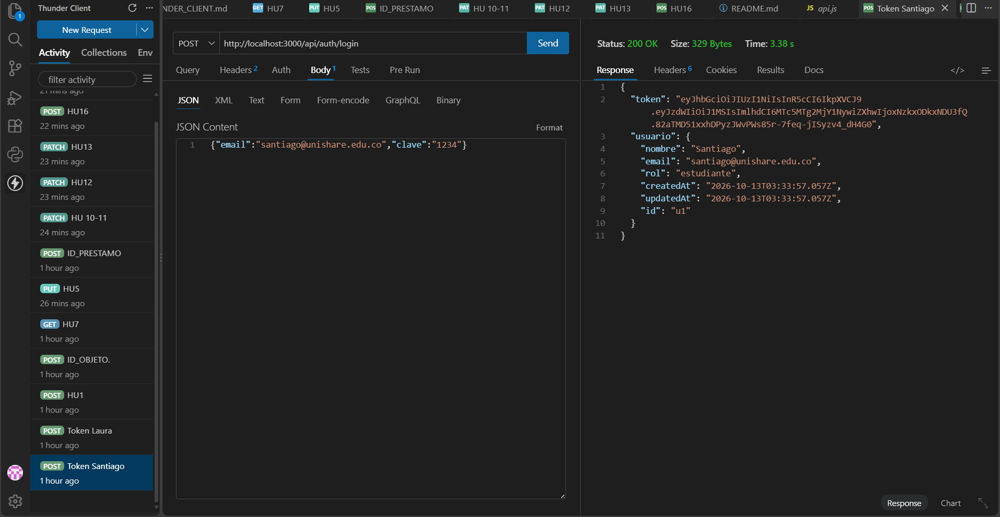

## Paso 2: login de Laura

- Método: POST
- URL: `http://localhost:3000/api/auth/login`
- Body:

```json
{"email":"laura@unishare.edu.co","clave":"1234"}
```

- Resultado: 200. Copia el `token` y guárdalo como **TOKEN_LAURA**.

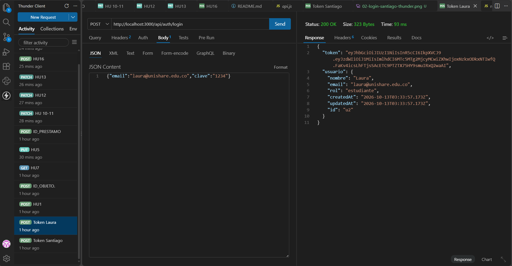

---

## Paso 3: registro (HU-01)

- Método: POST
- URL: `http://localhost:3000/api/auth/registro`
- Sin token
- Body:

```json
{"nombre":"Camila Prueba","email":"camila.prueba@unishare.edu.co","clave":"1234","rol":"estudiante"}
```

- Resultado: 201 con token. Si lo repites con el mismo correo, sale 400.

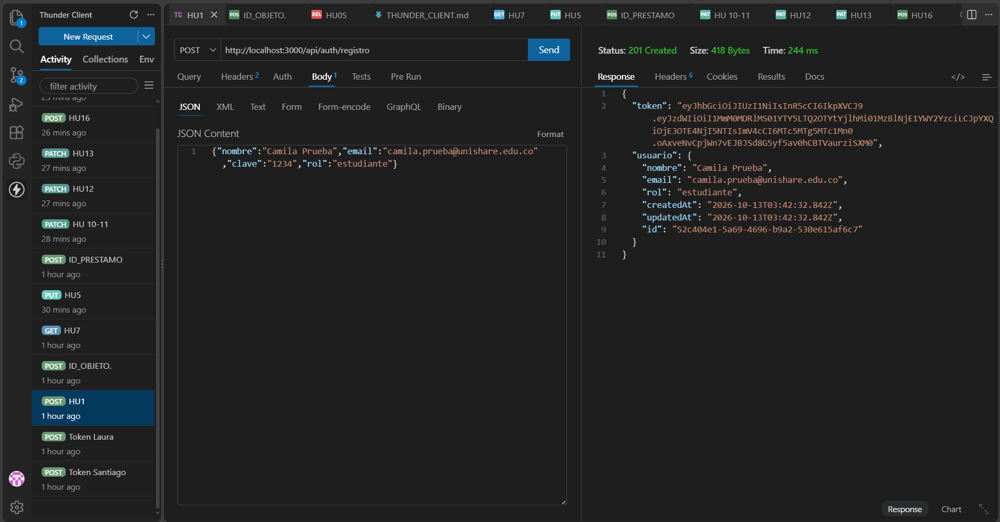

## Paso 4: publicar objeto (HU-04)

- Método: POST
- URL: `http://localhost:3000/api/objetos`
- Token: **TOKEN_SANTIAGO**
- Body:

```json
{"nombre":"Cautín de soldar","descripcion":"Cautín de 60 W con soporte, ideal para prácticas de electrónica.","categoria":"Herramientas","tarifa":3000,"garantia":25000,"maxDias":5,"fotos":[]}
```

- Resultado: 201. Copia el `id` de la respuesta y guárdalo como **ID_OBJETO**.
- En MongoDB: aparece un objeto nuevo en la colección `objetos`.

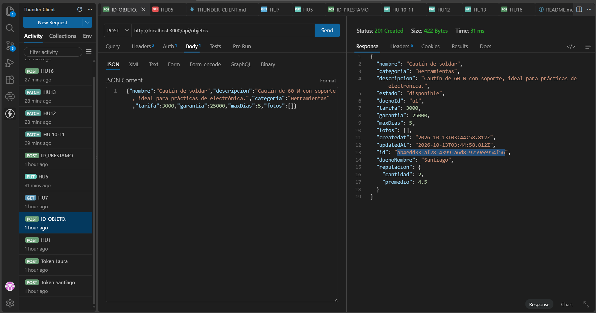

## Paso 5: buscar (HU-07)

- Método: GET
- URL: `http://localhost:3000/api/objetos?texto=taladro&categoria=Herramientas`
- Sin token
- Resultado: 200 con el taladro.

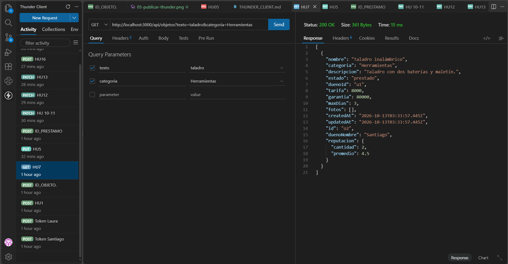

## Paso 6: editar objeto (HU-05)

- Método: PUT
- URL: `http://localhost:3000/api/objetos/ID_OBJETO`
- Token: **TOKEN_SANTIAGO**
- Body:

```json
{"nombre":"Cautín de soldar 60 W","descripcion":"Cautín de 60 W con soporte, ideal para prácticas de electrónica.","categoria":"Herramientas","tarifa":3500,"garantia":25000,"maxDias":5}
```

- Resultado: 200 con `tarifa: 3500`.
- En MongoDB: la tarifa del objeto cambió a 3500.

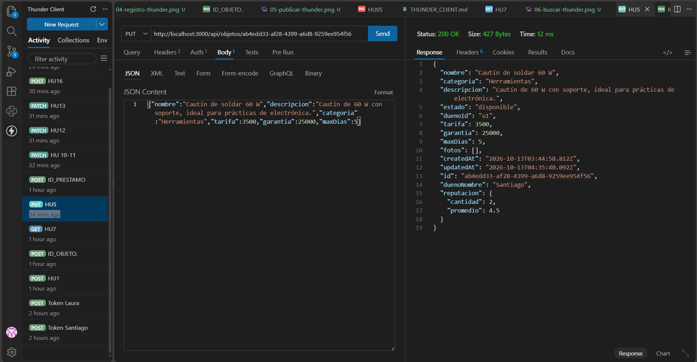

## Paso 7: solicitar préstamo (HU-09)

- Método: POST
- URL: `http://localhost:3000/api/prestamos`
- Token: **TOKEN_SANTIAGO**
- Body:

```json
{"objetoId":"o4","dias":3}
```

- Resultado: 201 con `total: 36000`. Copia el `id` y guárdalo como **ID_PRESTAMO**.
- En MongoDB: aparece un préstamo nuevo en `prestamos`.

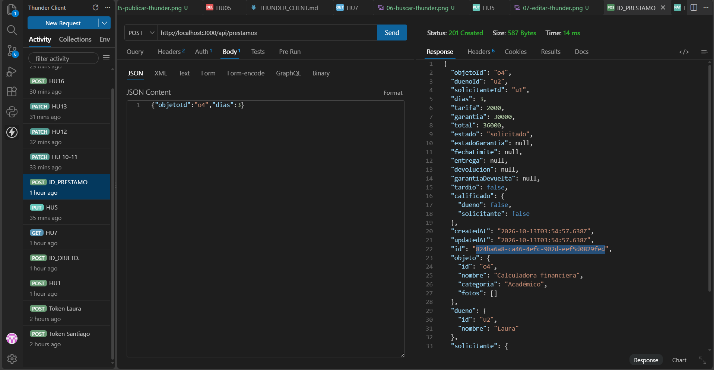

## Paso 8: aceptar solicitud (HU-10 y HU-11)

- Método: PATCH
- URL: `http://localhost:3000/api/prestamos/ID_PRESTAMO/responder`
- Token: **TOKEN_LAURA**
- Body:

```json
{"aceptar":true}
```

- Resultado: 200 con `estado: "aceptado"` y `estadoGarantia: "retenida"`.

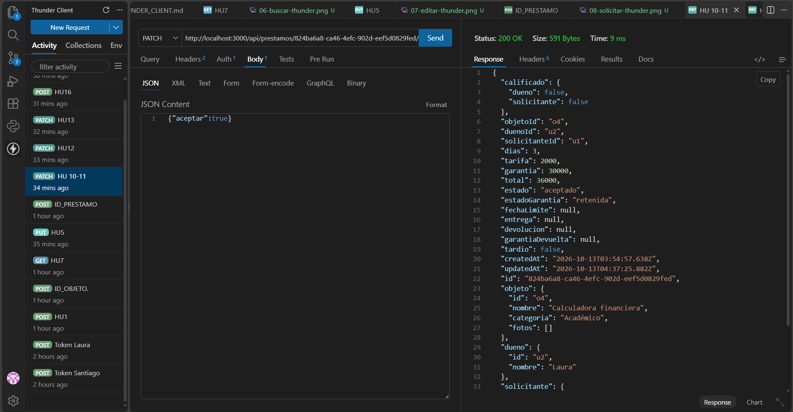

## Paso 9: registrar entrega (HU-12)

- Método: PATCH
- URL: `http://localhost:3000/api/prestamos/ID_PRESTAMO/entrega`
- Token: **TOKEN_LAURA**
- Body:

```json
{"descripcion":"Calculadora en perfecto estado, con funda y manual.","fotos":[]}
```

- Resultado: 200 con `estado: "activo"`.

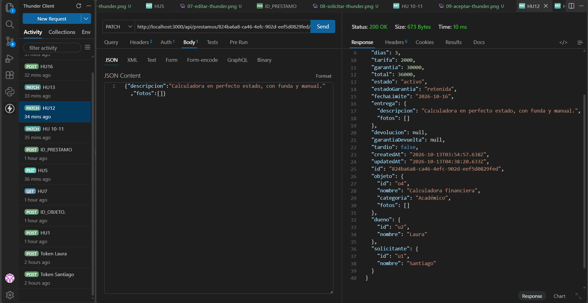

## Paso 10: devolución con daño (HU-13)

- Método: PATCH
- URL: `http://localhost:3000/api/prestamos/ID_PRESTAMO/devolucion`
- Token: **TOKEN_LAURA**
- Body:

```json
{"descripcion":"Regresa con la pantalla rayada.","hayDanio":true,"monto":10000,"descripcionDanio":"Rayón visible en la pantalla.","fotos":[]}
```

- Resultado: 200 con `estado: "devuelto"` y `garantiaDevuelta: 20000`.

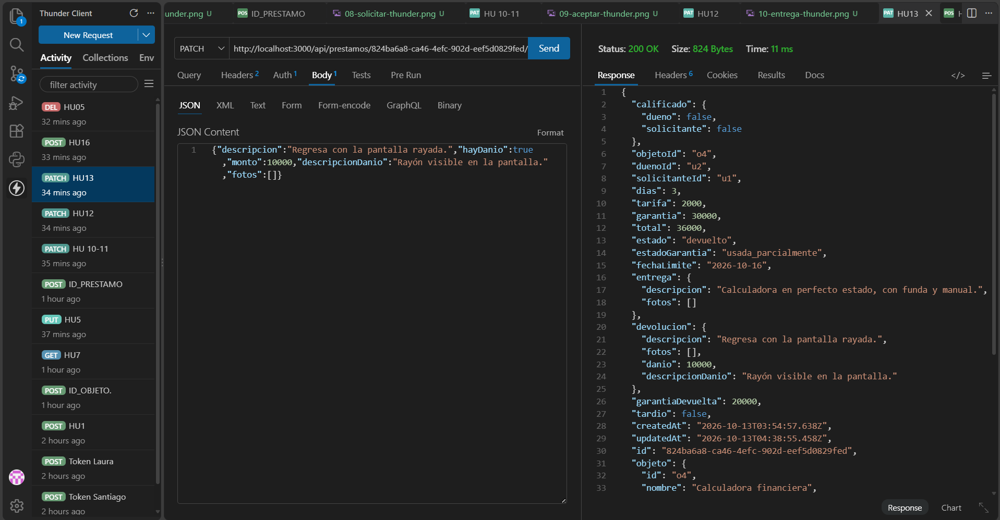

## Paso 11: calificar (HU-16)

- Método: POST
- URL: `http://localhost:3000/api/prestamos/ID_PRESTAMO/calificacion`
- Token: **TOKEN_SANTIAGO**
- Body:

```json
{"puntos":5,"comentario":"Muy responsable."}
```

- Resultado: 200. Si lo repites, sale 409.
- En MongoDB: aparece una calificación nueva en `calificaciones`.

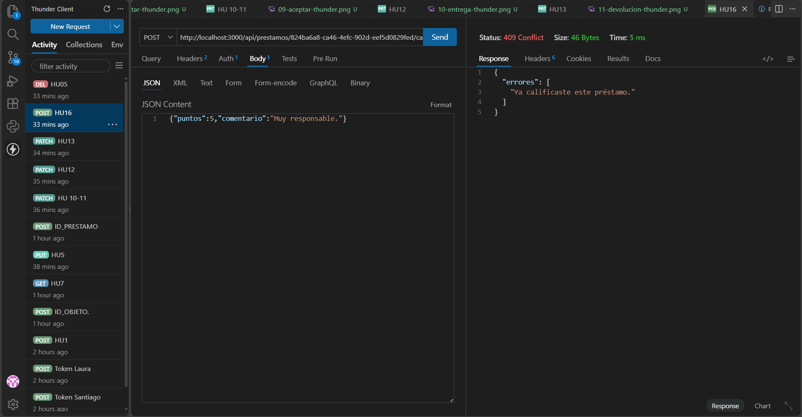

## Paso 12: eliminar objeto (HU-05)

- Método: DELETE
- URL: `http://localhost:3000/api/objetos/ID_OBJETO`
- Token: **TOKEN_SANTIAGO**
- Resultado: 200 con `"mensaje": "Objeto eliminado."`.
- En MongoDB: el objeto desaparece de `objetos`.


