# Cómo probar UniShare con Thunder Client

## Antes de empezar

1. En la terminal, dentro de la carpeta del proyecto, corre `npm start` (sin `NODE_ENV=production`, para que existan las cuentas de prueba).
2. Debe salir "Conectado a MongoDB". Si no sale, no sigas.
3. En VS Code, abre Thunder Client (el ícono del rayo).

## Importante: la sesión va en una cookie

La API ya **no** usa `Authorization: Bearer`. Al hacer login (o registro) el servidor responde con la cookie httpOnly `token`, y Thunder Client la guarda y la envía sola en las siguientes peticiones (pestaña **Cookies** de la respuesta para verla).

- No pongas nada en **Auth**.
- Solo hay una cookie a la vez: **el último login es el usuario activo**. Por eso los pasos están agrupados por usuario y antes de cada bloque se vuelve a iniciar sesión.
- Si las cookies no se guardan, activa en la configuración de Thunder Client la opción **Save Cookies**, o copia el valor del `token` y envíalo a mano en **Headers** como `Cookie: token=EL_TOKEN`.

Donde veas `ID_OBJETO` o `ID_PRESTAMO`, **no los escribas tal cual**. Reemplázalos por el valor real que copiaste de la respuesta anterior.

## Cómo hacer una petición

1. Elige el método (GET, POST, PUT, PATCH o DELETE).
2. Escribe la URL completa, empezando con `http://localhost:3000`.
3. Si tiene cuerpo, ve a **Body**, elige **JSON** y pega el texto.
4. Pulsa **Send**.

---

## Paso 0: reiniciar los datos

Hazlo antes de cada demo (también deja los correos de prueba con `@uniautonoma.edu.co`). Solo funciona en desarrollo; en producción responde 404.

- Método: POST
- URL: `http://localhost:3000/api/reiniciar`
- Sin body
- Resultado: 200 con `{"ok": true}`

---

## Paso 1: registro (HU-01)

- Método: POST
- URL: `http://localhost:3000/api/auth/registro`
- Body:

```json
{"nombre":"Camila Prueba","email":"camila.prueba@uniautonoma.edu.co","clave":"1234","rol":"estudiante"}
```

- Resultado: 201 con el `usuario` y la cookie `token`. Si lo repites con el mismo correo, sale 400. Si usas otro dominio (por ejemplo `@gmail.com`), también sale 400.

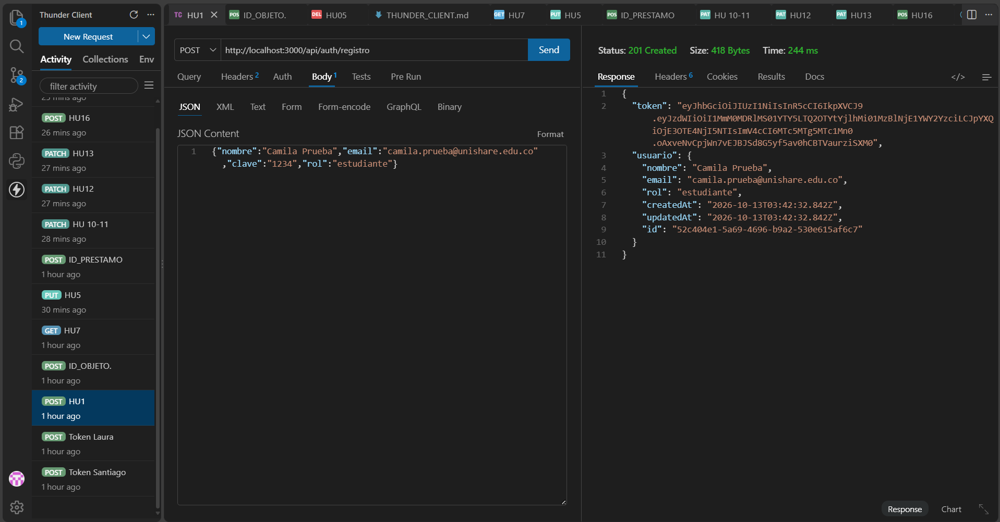

---

## Bloque Santiago

## Paso 2: login de Santiago (HU-02)

- Método: POST
- URL: `http://localhost:3000/api/auth/login`
- Body:

```json
{"email":"santiago@uniautonoma.edu.co","clave":"1234"}
```

- Resultado: 200 con el `usuario` y la cookie `token`. Desde aquí actúas como Santiago.

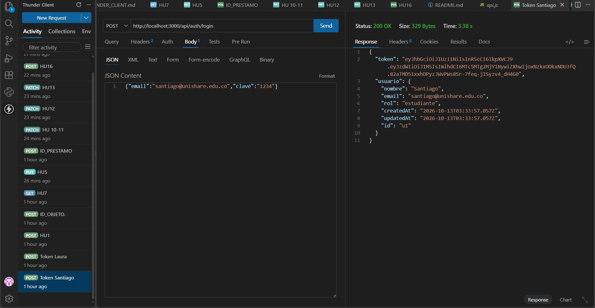

## Paso 3: publicar objeto (HU-04)

- Método: POST
- URL: `http://localhost:3000/api/objetos`
- Sesión: Santiago
- Body:

```json
{"nombre":"Cautín de soldar","descripcion":"Cautín de 60 W con soporte, ideal para prácticas de electrónica.","categoria":"Herramientas","tarifa":3000,"garantia":25000,"maxDias":5,"fotos":[]}
```

- Resultado: 201. Copia el `id` de la respuesta y guárdalo como **ID_OBJETO**.
- En MongoDB: aparece un objeto nuevo en la colección `objetos`.

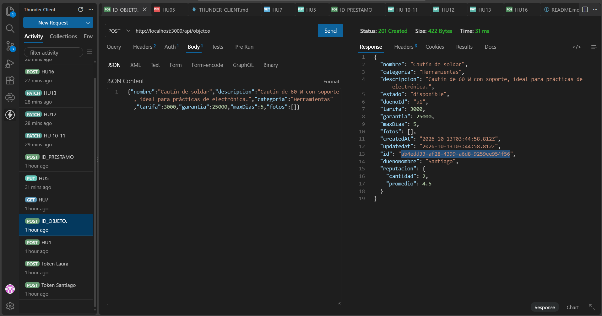

## Paso 4: buscar (HU-07)

- Método: GET
- URL: `http://localhost:3000/api/objetos?texto=taladro&categoria=Herramientas`
- No necesita sesión
- Resultado: 200 con el taladro.

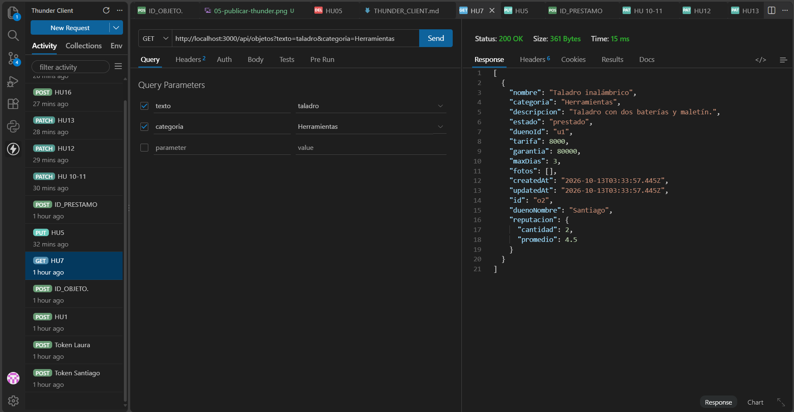

## Paso 5: editar objeto (HU-05)

- Método: PUT
- URL: `http://localhost:3000/api/objetos/ID_OBJETO`
- Sesión: Santiago
- Body:

```json
{"nombre":"Cautín de soldar 60 W","descripcion":"Cautín de 60 W con soporte, ideal para prácticas de electrónica.","categoria":"Herramientas","tarifa":3500,"garantia":25000,"maxDias":5}
```

- Resultado: 200 con `tarifa: 3500`.
- En MongoDB: la tarifa del objeto cambió a 3500.

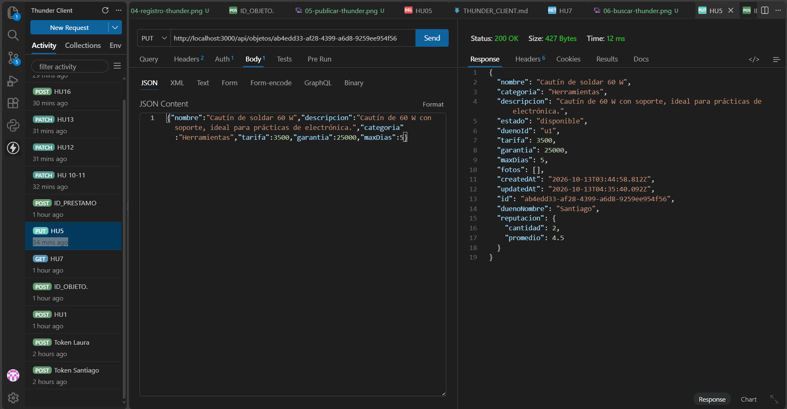

## Paso 6: solicitar préstamo (HU-09)

- Método: POST
- URL: `http://localhost:3000/api/prestamos`
- Sesión: Santiago
- Body:

```json
{"objetoId":"o4","dias":3}
```

- Resultado: 201 con `total: 36000`. Copia el `id` y guárdalo como **ID_PRESTAMO**.
- En MongoDB: aparece un préstamo nuevo en `prestamos`.

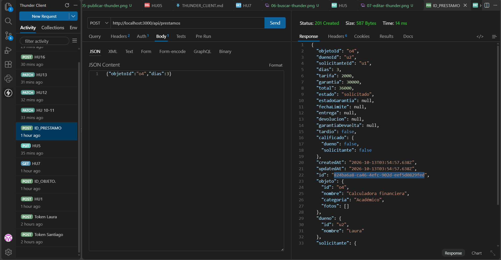

---

## Bloque Laura (dueña de la calculadora `o4`)

## Paso 7: login de Laura

- Método: POST
- URL: `http://localhost:3000/api/auth/login`
- Body:

```json
{"email":"laura@uniautonoma.edu.co","clave":"1234"}
```

- Resultado: 200. La cookie ahora es la de Laura.

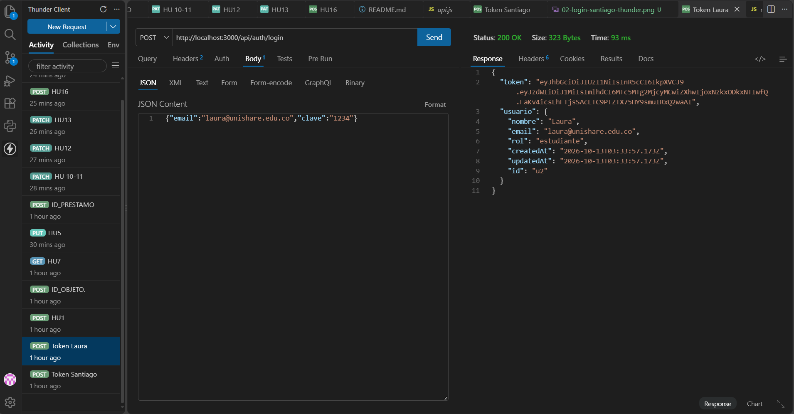

## Paso 8: aceptar solicitud (HU-10 y HU-11)

- Método: PATCH
- URL: `http://localhost:3000/api/prestamos/ID_PRESTAMO/responder`
- Sesión: Laura
- Body:

```json
{"aceptar":true}
```

- Resultado: 200 con `estado: "aceptado"` y `estadoGarantia: "retenida"`.

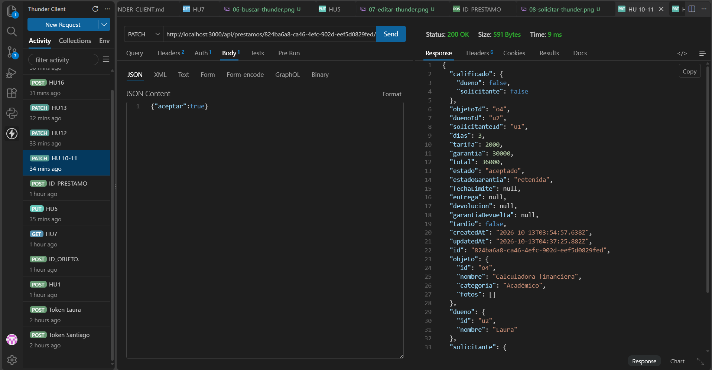

## Paso 9: registrar entrega (HU-12)

- Método: PATCH
- URL: `http://localhost:3000/api/prestamos/ID_PRESTAMO/entrega`
- Sesión: Laura
- Body:

```json
{"descripcion":"Calculadora en perfecto estado, con funda y manual.","fotos":[]}
```

- Resultado: 200 con `estado: "activo"`.

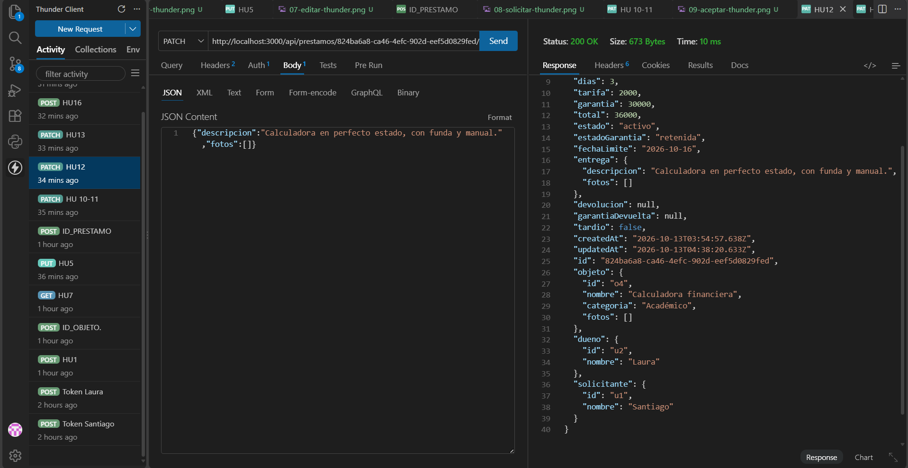

## Paso 10: devolución con daño (HU-13)

- Método: PATCH
- URL: `http://localhost:3000/api/prestamos/ID_PRESTAMO/devolucion`
- Sesión: Laura
- Body:

```json
{"descripcion":"Regresa con la pantalla rayada.","hayDanio":true,"monto":10000,"descripcionDanio":"Rayón visible en la pantalla.","fotos":[]}
```

- Resultado: 200 con `estado: "devuelto"` y `garantiaDevuelta: 20000`.

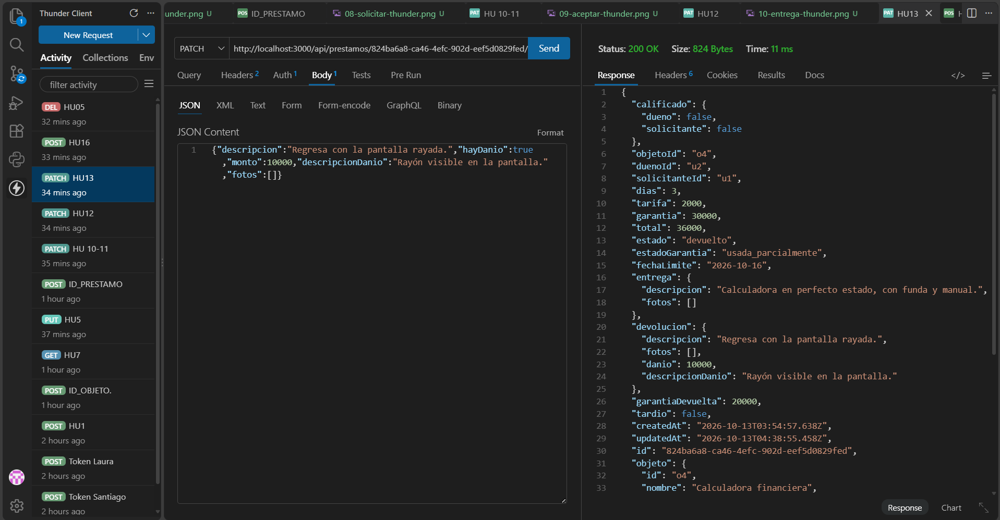

---

## Bloque Santiago otra vez

Repite el **Paso 2** (login de Santiago) para que la cookie vuelva a ser la suya.

## Paso 11: calificar (HU-16)

- Método: POST
- URL: `http://localhost:3000/api/prestamos/ID_PRESTAMO/calificacion`
- Sesión: Santiago
- Body:

```json
{"puntos":5,"comentario":"Muy responsable."}
```

- Resultado: 200. Si lo repites, sale 409.
- En MongoDB: aparece una calificación nueva en `calificaciones`.

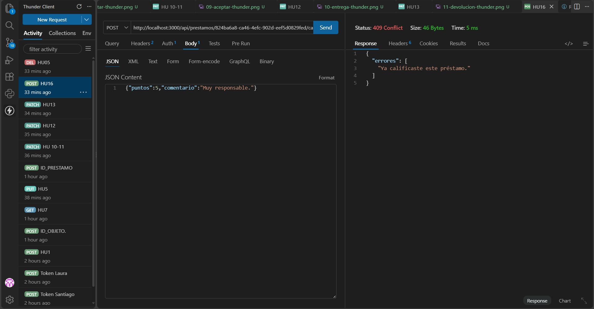

## Paso 12: eliminar objeto (HU-05)

- Método: DELETE
- URL: `http://localhost:3000/api/objetos/ID_OBJETO`
- Sesión: Santiago
- Resultado: 200 con `"mensaje": "Objeto eliminado."`.
- En MongoDB: el objeto desaparece de `objetos`.

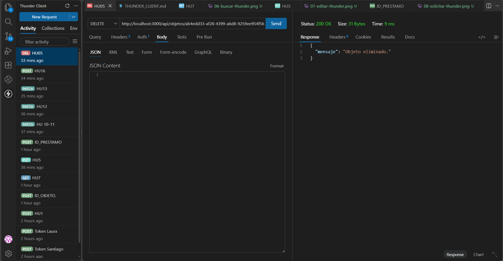

## Paso 13: cerrar sesión (HU-02)

- Método: POST
- URL: `http://localhost:3000/api/auth/salir`
- Resultado: 200 con `{"ok": true}` y la cookie `token` se borra. Si después llamas a `GET /api/auth/yo`, sale 401.
